# Execution Plan — 3rd-Party SLA Printer Support

## Detailed Analysis Summary

### Transformation Scope (Brownfield)
- **Transformation Type**: Single-subsystem, additive feature (not an architectural/infrastructure transformation).
- **Primary Changes**: New SLA output-conversion path (registry-registered writer per Strategy A), a UVtools acquisition+invocation module, a format-mapping layer, bundled printer profiles (Anycubic/Phrozen/Elegoo), and minimal SLA printer-settings GUI additions (UVtools override/status).
- **Related Components**: SLA format registry, SLAArchiveWriter, SLAPrinterConfig (possibly new keys), GUI SLA printer tab, build files (`CMakeLists.txt`). Core slicing (`SLAPrintSteps.cpp`, rasterization) is explicitly untouched.

### Change Impact Assessment
- **User-facing changes**: Yes — new printers in the picker, new export output format, fallback warnings, UVtools settings/status.
- **Structural changes**: Minimal — additive modules; a new entry in the SLA format registry; no change to the slicing architecture.
- **Data model changes**: Minor — possibly one or more new SLA printer config keys (target-format mapping / UVtools override); plus profile INI data.
- **API changes**: Internal only — a new `SLAArchiveWriter` subclass and a UVtools service module; no external/public API.
- **NFR impact**: Yes — downloading and executing an external binary (security: integrity verification, injection-safe invocation, fail-safe), graceful degradation (resiliency), and property-testable mapping/command logic (PBT).

### Component Relationships (Brownfield)
- **Primary Component**: `src/libslic3r/Format/` (new conversion writer + format mapping).
- **Supporting (new) Component**: UVtools acquisition/invocation module (download, verify, cache path, run subprocess).
- **Config Component**: `SLAPrinterConfig` (PrintConfig.hpp/.cpp) — potential new keys.
- **Data Component**: `resources/profiles/` — new/extended vendor INIs.
- **GUI Component**: `src/slic3r/GUI/Tab.cpp` (SLA printer settings surface) — minimal.
- **Dependent Components**: SLA export call sites (GUI `BackgroundSlicingProcess`, CLI `ProcessActions`) reach the writer via existing seam; no change needed for Strategy A.
- **Off-limits**: `SLAPrintSteps.cpp`, `SLA/RasterBase`, `AGGRaster` (core slicing).

### Risk Assessment
- **Risk Level**: Medium. New external dependency (download + execute + AGPL), subprocess/command-injection surface, multi-format correctness. Mitigated by additive design, verification, and fallback.
- **Rollback Complexity**: Easy — additive modules + a registry entry; revert the new files/profile data.
- **Testing Complexity**: Moderate — unit + property tests for mapping/command construction; integration test for download+convert; macOS validation per CON-3.

## Workflow Visualization

```mermaid
flowchart TD
    Start(["User Request"])

    subgraph INCEPTION["INCEPTION PHASE"]
        WD["Workspace Detection<br/><b>COMPLETED</b>"]
        RE["Reverse Engineering<br/><b>COMPLETED</b>"]
        RA["Requirements Analysis<br/><b>COMPLETED</b>"]
        US["User Stories<br/><b>COMPLETED</b>"]
        WP["Workflow Planning<br/><b>COMPLETED</b>"]
        AD["Application Design<br/><b>EXECUTE</b>"]
        UG["Units Generation<br/><b>EXECUTE</b>"]
    end

    subgraph CONSTRUCTION["CONSTRUCTION PHASE"]
        FD["Functional Design<br/><b>EXECUTE</b>"]
        NFRA["NFR Requirements<br/><b>EXECUTE</b>"]
        NFRD["NFR Design<br/><b>EXECUTE</b>"]
        ID["Infrastructure Design<br/><b>SKIP</b>"]
        CG["Code Generation<br/><b>EXECUTE</b>"]
        BT["Build and Test<br/><b>EXECUTE</b>"]
    end

    subgraph OPERATIONS["OPERATIONS PHASE"]
        OPS["Operations<br/><b>PLACEHOLDER</b>"]
    end

    Start --> WD
    WD --> RE
    RE --> RA
    RA --> US
    US --> WP
    WP --> AD
    AD --> UG
    UG --> FD
    FD --> NFRA
    NFRA --> NFRD
    NFRD --> ID
    ID --> CG
    CG --> BT
    BT --> OPS
    BT --> End(["Complete"])

    style WD fill:#4CAF50,stroke:#1B5E20,stroke-width:3px,color:#fff
    style RE fill:#4CAF50,stroke:#1B5E20,stroke-width:3px,color:#fff
    style RA fill:#4CAF50,stroke:#1B5E20,stroke-width:3px,color:#fff
    style US fill:#4CAF50,stroke:#1B5E20,stroke-width:3px,color:#fff
    style WP fill:#4CAF50,stroke:#1B5E20,stroke-width:3px,color:#fff
    style AD fill:#FFA726,stroke:#E65100,stroke-width:3px,stroke-dasharray: 5 5,color:#000
    style UG fill:#FFA726,stroke:#E65100,stroke-width:3px,stroke-dasharray: 5 5,color:#000
    style FD fill:#FFA726,stroke:#E65100,stroke-width:3px,stroke-dasharray: 5 5,color:#000
    style NFRA fill:#FFA726,stroke:#E65100,stroke-width:3px,stroke-dasharray: 5 5,color:#000
    style NFRD fill:#FFA726,stroke:#E65100,stroke-width:3px,stroke-dasharray: 5 5,color:#000
    style ID fill:#BDBDBD,stroke:#424242,stroke-width:2px,stroke-dasharray: 5 5,color:#000
    style CG fill:#4CAF50,stroke:#1B5E20,stroke-width:3px,color:#fff
    style BT fill:#4CAF50,stroke:#1B5E20,stroke-width:3px,color:#fff
    style OPS fill:#BDBDBD,stroke:#424242,stroke-width:2px,stroke-dasharray: 5 5,color:#000
    style INCEPTION fill:#BBDEFB,stroke:#1565C0,stroke-width:3px,color:#000
    style CONSTRUCTION fill:#C8E6C9,stroke:#2E7D32,stroke-width:3px,color:#000
    style OPERATIONS fill:#FFF59D,stroke:#F57F17,stroke-width:3px,color:#000
    style Start fill:#CE93D8,stroke:#6A1B9A,stroke-width:3px,color:#000
    style End fill:#CE93D8,stroke:#6A1B9A,stroke-width:3px,color:#000

    linkStyle default stroke:#333,stroke-width:2px
```

### Text alternative (workflow)
- INCEPTION: Workspace Detection (DONE) → Reverse Engineering (DONE) → Requirements (DONE) → User Stories (DONE) → Workflow Planning (DONE) → Application Design (EXECUTE) → Units Generation (EXECUTE)
- CONSTRUCTION (per unit): Functional Design (EXECUTE) → NFR Requirements (EXECUTE) → NFR Design (EXECUTE) → Infrastructure Design (SKIP) → Code Generation (EXECUTE) → Build and Test (EXECUTE)
- OPERATIONS: placeholder

## Phases to Execute

### INCEPTION PHASE
- [x] Workspace Detection (COMPLETED)
- [x] Reverse Engineering (COMPLETED)
- [x] Requirements Analysis (COMPLETED)
- [x] User Stories (COMPLETED)
- [x] Workflow Planning (IN PROGRESS → completing)
- [ ] Application Design — **EXECUTE**
  - **Rationale**: The feature introduces new components (convert-writer, UVtools acquisition/invocation service, format-mapping layer) whose responsibilities, methods, and dependencies need to be defined before coding.
- [ ] Units Generation — **EXECUTE**
  - **Rationale**: The work decomposes into distinct units with a dependency order (config/profiles → format mapping → UVtools acquisition → convert writer + fallback → GUI). Structured units enable clean, testable implementation.

### CONSTRUCTION PHASE (per unit)
- [ ] Functional Design — **EXECUTE**
  - **Rationale**: Format-id↔UVtools mapping and convert-command construction have real business logic and PBT properties (PBT-01) that must be designed.
- [ ] NFR Requirements — **EXECUTE**
  - **Rationale**: Security (download integrity, injection-safe subprocess), resiliency (retry/timeout/fallback), and PBT framework selection (PBT-09) must be pinned.
- [ ] NFR Design — **EXECUTE**
  - **Rationale**: Incorporate the verification, safe-invocation, and fallback patterns into the component design.
- [ ] Infrastructure Design — **SKIP**
  - **Rationale**: Desktop C++ application; no cloud/infra resources, deployment topology, or networking services introduced. (Download is a simple HTTPS fetch, covered under NFR, not infra.)
- [ ] Code Generation — **EXECUTE (ALWAYS)**
  - **Rationale**: Implement the feature.
- [ ] Build and Test — **EXECUTE (ALWAYS)**
  - **Rationale**: Compile on macOS, run unit/property/integration tests, validate success criteria.

### OPERATIONS PHASE
- [ ] Operations — PLACEHOLDER

## Success Criteria
- **Primary Goal**: Select a 3rd-party SLA printer (bundled or custom), export, and get a valid manufacturer-format file (via UVtools) — with a safe `.sl1` fallback + warning on failure.
- **Key Deliverables**: Convert-writer + registry entry; UVtools acquisition/verify/cache module; format-mapping layer; Anycubic/Phrozen/Elegoo profiles; minimal GUI settings; tests.
- **Quality Gates**: Existing SL1/Anycubic outputs + core slicing unchanged; security (verified download, injection-safe invocation, fail-safe); PBT on mapping/command logic; builds on macOS.

## Notes / Assumptions
- **Assumption A-1** (from requirements): Strategy A serves GUI + CLI from one seam; GUI is the validated target this pass. Carried forward unless you say otherwise.
- **Spike dependency**: exact `UVtools.Cmd convert` syntax, format identifiers, and download/verification details must be confirmed during Functional/NFR design (Open Items in requirements.md).
